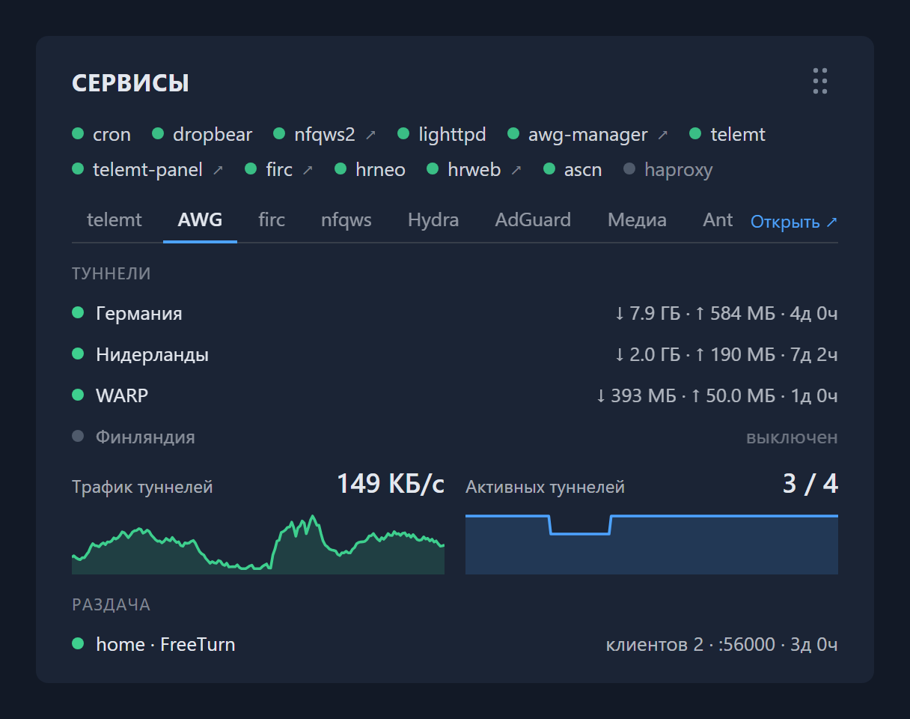
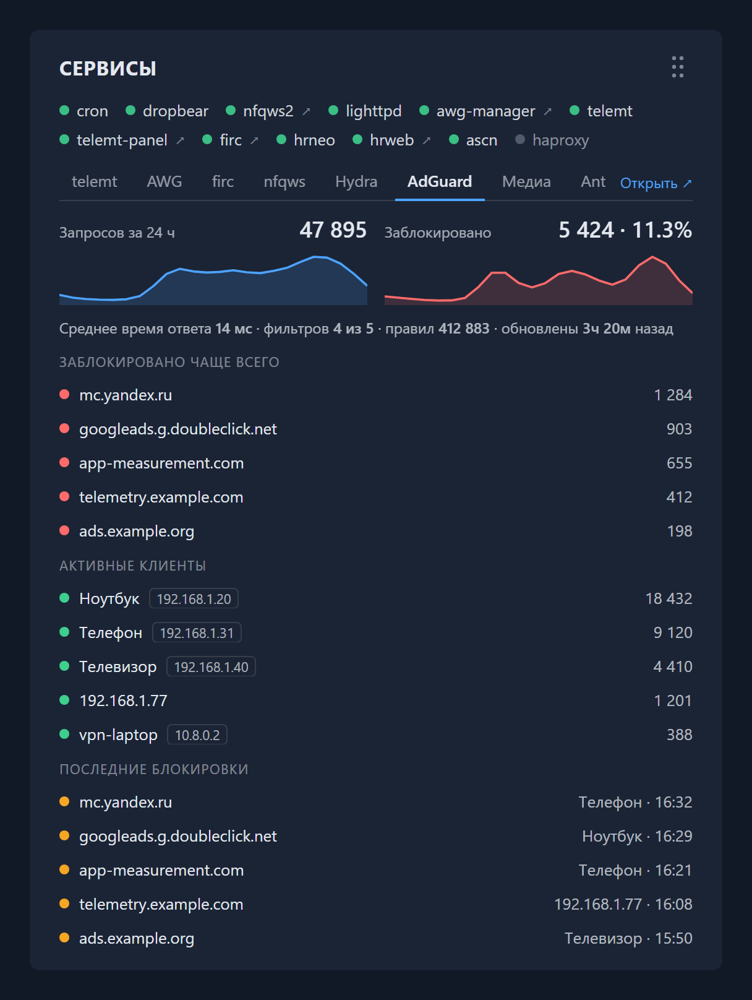
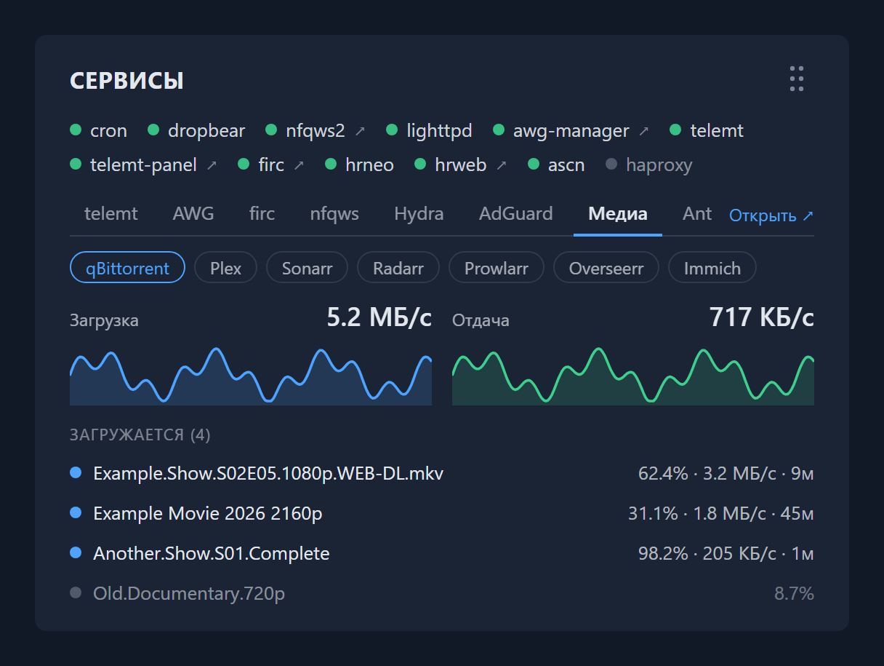

# keendash

Карточка «Сервисы» на главной странице веб-интерфейса Keenetic (NDMS) для сервисов, установленных через Entware.



- статус всех init.d-сервисов Entware (`S99firc` → `firc`), ссылки на их веб-страницы (порты и заголовки определяются автоматически);
- вкладки с подробностями и графиками для поддерживаемых сервисов (список ниже), вкладка показывается, только если сервис установлен;
- раз в 6 часов проверяет, вышла ли новая версия keendash, и предлагает обновиться кнопкой на карточке;
- карточку можно перетаскивать, как родные карточки Keenetic.

<details>
<summary>Поддерживаемые сервисы</summary>

| Вкладка | Сервис | Что показывает |
|---|---|---|
| telemt | telemt, telemt-panel | подключения, трафик, пользователи онлайн, аптайм, неудачные подключения |
| AWG | awg-manager | туннели (AmneziaWG, WireGuard, sing-box, OpkgTun): состояние, трафик, аптайм; раздача FreeTurn и WDTT |
| firc | firc | домены в пуле, группы и их интерфейсы |
| nfqws | nfqws2, nfqws-keenetic | процесс, пакеты в обработке, списки доменов, доступность сайтов из монитора nfqws-ui, события автолиста |
| Hydra | HydraRoute Neo (hrneo, hrweb) | процесс, правила (политики Keenetic и интерфейсы DirectRoute): домены и адреса в ipset |
| Antiscan | Antiscan | заблокированные адреса и подсети, ловушка, последние баны со странами |
| Система | — | нагрузка CPU, память, температура, диск `/opt`, аптайм |

Ссылка «Открыть» на вкладке ведёт в веб-интерфейс сервиса, если он есть.

</details>

<details>
<summary>Сторонние сервисы</summary>

Сервисы на роутере или на любом хосте в сети, данные берутся из их API. Вкладка появляется только после [настройки](#сторонние-сервисы).

| Вкладка | Сервис | Что показывает |
|---|---|---|
| AdGuard | AdGuard Home | запросы и блокировки с графиками, среднее время ответа, фильтры, топ заблокированных доменов, активные клиенты, последние блокировки |
| Медиа | qBittorrent | скорость загрузки и отдачи с графиками, активные загрузки: прогресс, скорость, сколько осталось |
| | Plex | кто и что смотрит сейчас, библиотеки |
| | Sonarr, Radarr | очередь загрузок, сколько не скачано, что выходит на этой неделе |
| | Prowlarr | индексаторы, отключённые после ошибок, запросы и скачивания за сутки |
| | Overseerr | запросы: ждут одобрения, в работе, доступны |
| | Immich | фото, видео, занятое место, по пользователям |

Если на вкладке «Медиа» больше одного сервиса, у каждого своя подвкладка.

 

</details>

Работает на любых Keenetic с Entware.

## Установка

Узнайте архитектуру Entware (`opkg print-architecture`: `aarch64-3.10`, `mipsel-3.4` или `mips-3.4`), добавьте фид и установите пакет:

```sh
echo "src/gz keendash https://dnstkrv.github.io/keendash/aarch64-3.10" >> /opt/etc/opkg.conf
opkg update && opkg install keendash
```

Зависимости (`lighttpd`, `lighttpd-mod-cgi`, `cron`) установятся автоматически. После установки обновите страницу роутера (Ctrl+F5). Обновление: кнопкой на карточке или `opkg update && opkg upgrade keendash`.

## Настройка

Все настройки в одном файле `/opt/etc/keendash/keendash.conf`:

```sh
PORT=8189          # порт веб-сервера виджета
LAN_IFACE="br0"    # интерфейс, на чьём адресе слушает сервер
LAN_IP=""          # или явный адрес
GEO=1              # страны у адресов Antiscan (0 = выключить)
LINKS="            # ручные ссылки на веб-страницы сервисов
firc=666
telemt=hide
"
```

Значения `LINKS`: `имя=порт`, `имя=http://хост/путь`, `имя=-` (без ссылки), `имя=hide` (скрыть сервис). После правки: `/opt/etc/init.d/S81keendash restart`. Сервисы и порты автообнаруживаются раз в 5 минут, принудительно: `/opt/share/keendash/bin/services --discover`.

### Сторонние сервисы

По умолчанию выключены: в `keendash.conf` все их ключи закомментированы. Сервис включается, когда его ключи раскомментированы и заполнены; включайте только нужные:

```sh
# AdGuard Home: адрес веб-интерфейса, логин и пароль от него
ADGUARD_URL="http://192.168.1.10:3000"
ADGUARD_USER="admin"
ADGUARD_PASS="пароль"

# qBittorrent: адрес веб-интерфейса, логин и пароль (пустые, если вход без пароля для локальной сети)
QBIT_URL="http://192.168.1.10:8080"
QBIT_USER="admin"
QBIT_PASS="пароль"

# Plex: адрес и токен (X-Plex-Token)
PLEX_URL="http://192.168.1.10:32400"
PLEX_TOKEN="токен"

# Sonarr, Radarr, Prowlarr, Overseerr: адрес и API-ключ
SONARR_URL="http://192.168.1.10:8989"
SONARR_KEY="ключ"
RADARR_URL="http://192.168.1.10:7878"
RADARR_KEY="ключ"
PROWLARR_URL="http://192.168.1.10:9696"
PROWLARR_KEY="ключ"
OVERSEERR_URL="http://192.168.1.10:5055"
OVERSEERR_KEY="ключ"

# Immich: адрес и API-ключ администратора
IMMICH_URL="http://192.168.1.10:2283"
IMMICH_KEY="ключ"
```

Где взять ключи:

- Sonarr, Radarr, Prowlarr, Overseerr: Settings → General → API Key;
- Immich: Настройки аккаунта → API-ключи, ключ администратора с правом `server.statistics`;
- Plex: токен виден в адресе страницы «View XML» у любого фильма ([инструкция Plex](https://support.plex.tv/articles/204059436-finding-an-authentication-token-x-plex-token/)).

Перезапуск не нужен: вкладка появится сразу, а данные keendash спрашивает у сервисов раз в минуту в фоне, поэтому первые цифры придут в течение минуты. Удалите `*_URL`, чтобы убрать сервис. Если сервис стоит на самом роутере, можно указать `http://127.0.0.1:порт`, ссылка «Открыть» всё равно поведёт на адрес роутера.

Пароли и ключи хранятся в `keendash.conf` открытым текстом, поэтому ограничьте доступ к файлу: `chmod 600 /opt/etc/keendash/keendash.conf`.

### Страны в Antiscan

Коды стран определяются через ip-api.com по **HTTP**, то есть заблокированные адреса уходят с роутера в сторонний сервис. Отключить: `GEO=0` в `keendash.conf`.

## Как это работает

`keendash` делает две вещи:

1. Запускает отдельную копию lighttpd (`keendash-httpd`) на LAN-адресе: CGI `status.cgi` отдаёт JSON, `widgets/services.js` — карточку.
2. Через `bin/patch` собирает копию `index.html` веб-интерфейса со вставленным загрузчиком и bind-mount'ит её поверх оригинала. Копия пересобирается при каждом старте, поэтому обновления прошивки не ломают патч. Откат: остановка сервиса (`S81keendash stop`) или удаление пакета.

Cron (`/opt/etc/cron.1min/keendash`) раз в минуту собирает метрики в `/tmp/keendash` (в RAM) для графиков и опрашивает API сторонних сервисов (`bin/ext`), карточка берёт их ответы оттуда и не ждёт медленные сервисы.

## Ограничения

- Только HTTP в локальной сети: при открытии роутера по HTTPS браузер заблокирует запросы (mixed content).

## Удаление

`opkg remove keendash`

## Лицензия

MIT
