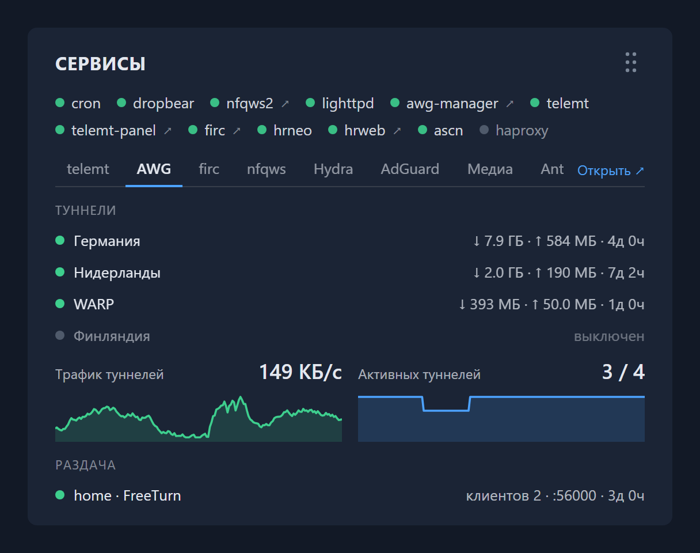
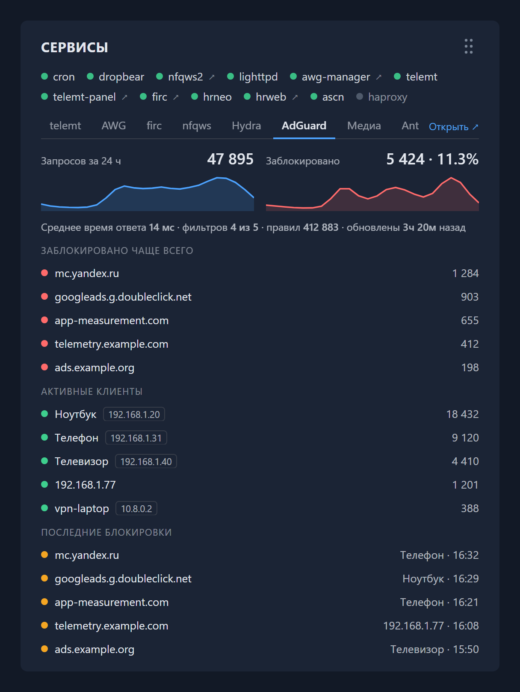
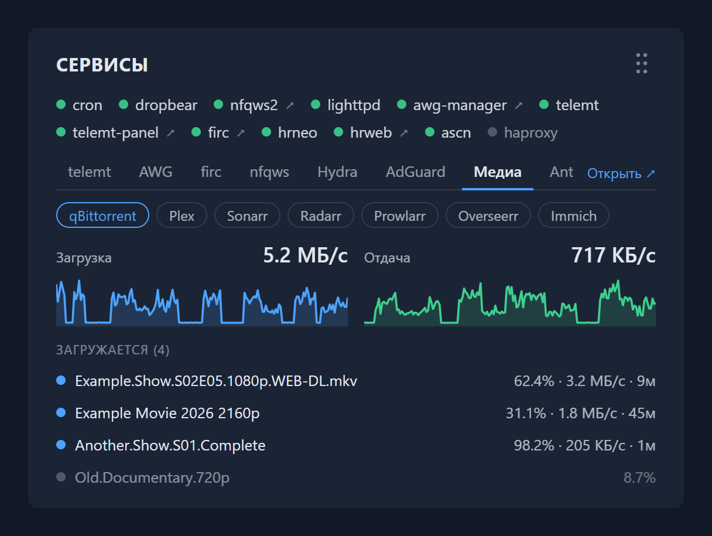

# keendash

Карточка «Сервисы» на главной странице веб-интерфейса Keenetic (NDMS) для сервисов, установленных через Entware.



<details>
<summary>Дополнительные изображения</summary>

 

</details>

- статус всех init.d-сервисов Entware (`S99firc` → `firc`), ссылки на их веб-страницы (порты и заголовки определяются автоматически);
- вкладки с подробностями и графиками для поддерживаемых сервисов (список ниже), вкладка показывается, только если сервис установлен;
- раз в 6 часов проверяет, вышла ли новая версия keendash, и предлагает обновиться кнопкой на карточке;
- карточку можно перетаскивать, как родные карточки Keenetic;
- пункт «Сервисы» в меню под «Системным монитором» открывает страницу, где у каждой вкладки своя карточка, у каждого медиасервиса тоже.

<details>
<summary>Поддерживаемые сервисы</summary>

| Вкладка | Сервис | Что показывает |
|---|---|---|
| telemt | telemt, telemt-panel | подключения, трафик, пользователи онлайн, аптайм, неудачные подключения |
| AWG | awg-manager | туннели (AmneziaWG, WireGuard, sing-box, OpkgTun): состояние, трафик, аптайм; раздача FreeTurn и WDTT |
| firc | firc | домены в пуле, группы и их интерфейсы |
| nfqws | nfqws2, nfqws-keenetic | процесс, пакеты в обработке, списки доменов, доступность сайтов из монитора nfqws-ui, события автолиста |
| Hydra | HydraRoute Neo (hrneo, hrweb) | процесс, правила (политики Keenetic и интерфейсы DirectRoute): домены и адреса в ipset |
| Tailscale | tailscale | трафик и устройства в сети с графиками, состояние и адрес роутера, выходной узел и подсети, устройства: как подключены, когда были в сети |
| Antiscan | Antiscan | заблокированные адреса и подсети, ловушка, последние баны со странами |
| Система | — | нагрузка CPU, память, температура, диск `/opt`, аптайм |

Ссылка «Открыть» на вкладке ведёт в веб-интерфейс сервиса, если он есть, у Tailscale — в его админку.

Если в awg-manager включён вход по паролю, keendash читает его API по API-ключу: сгенерируйте ключ в настройках awg-manager, keendash возьмёт его сам.

</details>

<details>
<summary>Сторонние сервисы</summary>

Сервисы на роутере или на любом хосте в сети, данные берутся из их API. Вкладка появляется только после [настройки](#сторонние-сервисы).

| Вкладка | Сервис | Что показывает |
|---|---|---|
| AdGuard | AdGuard Home | запросы и блокировки с графиками, среднее время ответа, фильтры, топ заблокированных доменов, активные клиенты, последние блокировки |
| Медиа | qBittorrent | скорость загрузки и отдачи с графиками, активные загрузки: прогресс, скорость, сколько осталось |
| | Plex | кто и что смотрит сейчас, библиотеки |
| | Sonarr, Radarr | очередь загрузок, сколько не скачано, что выходит на этой неделе |
| | Prowlarr | индексаторы, отключённые после ошибок, запросы и скачивания за сутки |
| | Overseerr | запросы: ждут одобрения, в работе, доступны |
| | Immich | фото, видео, занятое место, по пользователям |
| | Jellyfin | кто и что смотрит сейчас, библиотеки |
| | Jellyseerr | запросы: ждут одобрения, в работе, доступны |
| | Lidarr | очередь загрузок, сколько альбомов не скачано |
| | Bazarr | серии и фильмы без субтитров |
| | Tautulli | потоки, перекодирование, трафик |
| | SABnzbd, NZBGet | скорость загрузки, сколько осталось |
| | Transmission, Deluge | скорость загрузки и отдачи, число торрентов |
| | MeTube | загружается, суммарная скорость, готово, ошибок (логин нужен, только если MeTube закрыт Basic-входом) |
| Дом | Home Assistant | состояния выбранных сущностей (поле «Что показывать»: `Подпись=sensor.id`) |
| | Frigate | версия, детектор, занятое место, камеры: FPS, детекции, упавшие |
| | Moonraker | состояние печати, прогресс, сколько осталось, температуры сопла и стола |
| | Spoolman | катушек, остаток в граммах, сколько почти кончилось |
| Серверы | Uptime Kuma | сколько мониторов работает и упало, список с процентом за сутки и полосой последних 30 опросов (своя история за 24 часа хранится в памяти роутера) |
| | Grafana | версия, дашборды, сработавшие алерты |
| | Glances | CPU, память, swap, нагрузка |
| | Proxmox | узлы в сети, работающие ВМ и LXC, CPU |
| | Portainer | контейнеры: запущено, остановлено, всего |
| | TrueNAS | пулы, предупреждения, нагрузка, время работы |
| | OpenMediaVault | время работы, нагрузка, память |
| Сеть | Pi-hole | запросы и блокировки с графиками за сутки, топ заблокированных доменов, активные клиенты (только Pi-hole v6) |
| | NextDNS | запросов за сутки, заблокировано, доля блокировок |
| | Speedtest Tracker | загрузка, отдача, пинг, сколько прошло с последнего замера |
| | Nginx Proxy Manager | прокси-хосты (включённые из всех), перенаправления, потоки, когда истекает ближайший сертификат |
| | Traefik | роутеры, сервисы, предупреждения и ошибки |
| Файлы | Nextcloud | свободное место, активные за сутки, файлы, общие ссылки (токен serverinfo или логин администратора и пароль приложения) |
| | Syncthing | синхронизировано, осталось, устройства в сети, папки (API-ключ; адрес GUI должен слушать сеть, сертификат не проверяется) |
| | Paperless-ngx | документы, во входящих, теги, корреспонденты (токен: профиль → API Auth Token) |
| Другое | Gitea / Forgejo | уведомления, открытые задачи и PR, репозитории (токен с правами read на repository, issue, notification) |
| | Свой API | любой адрес с JSON: плитки по вашему списку |
| Доступность | Доступность сайтов | отвечают ли ваши домены и адреса: код и время ответа, доступность за 24 часа |

Если на вкладке «Медиа» больше одного сервиса, у каждого своя подвкладка.

</details>

Работает на любых Keenetic с Entware.

## Установка

Узнайте архитектуру Entware (`opkg print-architecture`: `aarch64-3.10`, `mipsel-3.4` или `mips-3.4`), добавьте фид и установите пакет:

```sh
echo "src/gz keendash https://dnstkrv.github.io/keendash/aarch64-3.10" > /opt/etc/opkg/keendash.conf
opkg update && opkg install keendash
```

Других пакетов не нужно: хватает базового Entware. После установки обновите страницу роутера (Ctrl+F5). Обновление: кнопкой на карточке или `opkg update && opkg upgrade keendash`.

## Настройка

Все настройки в одном файле `/opt/etc/keendash/keendash.conf`:

```sh
PORT=8189          # порт веб-сервера виджета
LAN_IFACE="br0"    # интерфейс, на чьём адресе слушает сервер
LAN_IP=""          # или явный адрес
GEO=1              # страны у адресов Antiscan (0 = выключить)
LINKS="            # ручные ссылки на веб-страницы сервисов
firc=666
telemt=hide
"
```

Значения `LINKS`: `имя=порт`, `имя=http://хост/путь`, `имя=-` (без ссылки), `имя=hide` (скрыть сервис). После правки: `/opt/etc/init.d/S81keendash restart`. Сервисы и порты автообнаруживаются раз в 5 минут, принудительно: `/opt/share/keendash/bin/services --discover`.

### Сторонние сервисы

Сервисы AdGuard Home, qBittorrent, Plex, Sonarr, Radarr, Prowlarr, Overseerr и Immich (а также новые типы из таблицы выше) больше не настраиваются в `keendash.conf`. Их добавляют, правят и удаляют в окне «Настройки» на странице «Сервисы». Тип можно добавить несколько раз (например, два qBittorrent). При обновлении старые ключи `ADGUARD_*`, `QBIT_*` и т. д. сами переезжают в `/opt/etc/keendash/services/<id>.conf`.

Поля окна: «Адрес» (веб-интерфейс сервиса), «Логин» и «Пароль» (AdGuard Home, Pi-hole (только пароль, можно пустой, если в Pi-hole не задан), Nginx Proxy Manager (e-mail пользователя), Traefik (только при basicAuth), qBittorrent, Transmission, NZBGet, Frigate (порт 8971), Glances, OpenMediaVault, Nextcloud (если нет токена), MeTube (только с Basic-входом); Deluge только пароль; у Proxmox в «Логине» ID токена; логин и пароль можно не задавать там, где сервис пускает адрес роутера без них: белые списки qBittorrent и NZBGet; в Transmission логин не нужен, если выключен вход, `rpc-authentication-required`), «API-ключ» (NextDNS, Sonarr, Radarr, Prowlarr, Overseerr, Immich, Jellyfin, Jellyseerr, Lidarr, Bazarr, Tautulli, SABnzbd, Uptime Kuma, Proxmox, Portainer, TrueNAS, Nextcloud, Syncthing, Paperless-ngx, Gitea / Forgejo), «Токен» (Speedtest Tracker, Plex, Home Assistant, Grafana), «Что показывать» (Home Assistant и «Свой API»; до 8 пар), «Адреса» и «Интервал» («Доступность сайтов»). Где взять ключи:

- Sonarr, Radarr, Prowlarr, Overseerr: Settings → General → API Key, в поле «API-ключ»;
- Jellyfin: Панель управления → API-ключи → +; Jellyseerr, Lidarr, Bazarr: Settings → General (Bazarr: Security) → API Key; Tautulli: Settings → Web Interface → API Key; SABnzbd: Config → General → API Key;
- Immich: Настройки аккаунта → API-ключи, ключ администратора с правом `server.statistics`, в поле «API-ключ»;
- Plex: токен виден в адресе страницы «View XML» у любого фильма ([инструкция Plex](https://support.plex.tv/articles/204059436-finding-an-authentication-token-x-plex-token/)), в поле «Токен»;
- Uptime Kuma: Settings → API Keys; Portainer: My account → Access tokens; TrueNAS: Credentials → API Keys (TrueNAS до 25.10); Grafana: Administration → Service accounts, роль Viewer, в поле «Токен»; Home Assistant: Профиль → Безопасность → Долгосрочные токены, в поле «Токен»;
- NextDNS: в «Логин» ID профиля (Setup, 6 символов), API-ключ внизу страницы Account; Speedtest Tracker: Settings → API Tokens, право `results:read`;
- Pi-hole: только v6; пароль веб-интерфейса или пароль приложения (Settings → Web interface / API → App password). keendash входит на время опроса и выходит сам, иначе сессии копились бы до лимита и Pi-hole отвечал бы 429; Nginx Proxy Manager: лучше отдельный пользователь с правом только просмотра; Traefik: адрес API (`api.insecure`, порт 8080, или роутер на `api@internal`);
- Proxmox: Datacenter → Permissions → API Tokens, роль PVEAuditor; в «Логин» ID токена (`root@pam!keendash`), в «API-ключ» его секрет. **Сертификат Proxmox, Frigate, TrueNAS и Syncthing не проверяется** (обычно он самоподписанный); остальные типы проверяют сертификат, для самоподписанного используйте http-адрес. TrueNAS — только https, ключ, отправленный по http, TrueNAS отзывает; Frigate — `https://хост:8971` с логином или `http://хост:5000` без.

#### Frigate: кадры с камер

Настройка «Кадры с камер» (Нет по умолчанию; Да включает): раз в минуту, вместе со сбором данных, keendash берёт кадр каждой камеры (до 8, в порядке списка в карточке; камеры с именем не из букв, цифр, `_` и `-` пропускаются) и показывает под её строкой. Кадры лежат только в `/tmp/mnt/.keendash/cam/`, то есть в оперативной памяти роутера, не на диске, и пропадают при перезагрузке. Их отдаёт веб-интерфейс роутера по пути `/storage/` и только вошедшему пользователю, поэтому **кадры видны только при входе в роутер по https**; по http в карточке одна подсказка. Сервер keendash в локальной сети входа не требует, поэтому кадры в его папку не кладутся. При выключении настройки или удалении карточки кадры стираются. Живого видео нет.

#### Доступность сайтов

Карточка проверяет список «Адреса»: до 20 доменов (`example.com`, `example.com:8443`) или адресов `http(s)://…` через пробел. Домен с нелатинскими буквами пишите латиницей (punycode, `xn--…`). Доступным считается любой HTTP-ответ, даже 404 и 5xx показываются отдельным цветом; нет ответа за 4 секунды значит «недоступен». «Интервал»: 1, 5, 15, 30 минут или 1 час (по умолчанию 5). Карточек можно создать сколько угодно, например отдельную для каждого набора адресов. История за 24 часа (процент доступности и полоска последних 30 проверок) хранится в памяти роутера и сбрасывается при перезагрузке.

#### Свой API и плитки

Тип «Свой API» читает любой адрес с JSON (GET). Поля: «Адрес», при необходимости «Логин» и «Пароль», «API-ключ», «Токен». В поле «Что показывать» через `;` (до 8 пар) пишут `Подпись=путь[:формат]`, например `Задачи=queue.total; Скорость=speed:bs`. Формат: `n` число, `b` байты, `bs` байты в секунду, `bit` биты в секунду (Мбит/с), `p` проценты, `s` секунды, без формата просто текст.

Ключ, вписанный в адрес (`?apikey=…`), хранится как обычное поле и виден в окне: лучше использовать поле «API-ключ» или «Токен».

Новый простой тип это один файл `ext.d/<тип>`, который печатает строки `t|Подпись|значение|формат` (форматы те же).

Перезапуск не нужен: вкладка появится сразу, а данные keendash спрашивает у сервисов раз в минуту в фоне, поэтому первые цифры придут в течение минуты. Если сервис стоит на самом роутере, можно указать `http://127.0.0.1:порт`, ссылка «Открыть» всё равно поведёт на адрес роутера.

В том же окне найденные сервисы можно скрыть отдельно на странице и на главной карточке. Карточки на странице перетаскиваются за «⋮⋮» (три колонки: карточка встаёт вплотную под ту, что выше в её колонке), расположение хранится на роутере и одинаково во всех браузерах. В «⋯» у карточки выбирается ширина (1/3, 2/3 или 3/3 страницы), «▾/▸» сворачивает её до шапки, «⚙» открывает настройки этого сервиса. Кнопка «Новая группа» создаёт группу: её можно переименовать и перетащить, карточки переносятся в неё и обратно, «Разгруппировать» возвращает карточки на страницу. На странице уже 900 px все карточки идут в один столбец.

Кнопка «Сканировать сеть» в окне настроек ищет сервисы: роутер обходит свои активные клиенты и себя, пробует стандартные порты и узнаёт сервис по ответу (пароли и ключи при этом не отправляются). Найденное показано блоком «Найдено в сети»: «Добавить выбранные» кладёт отмеченное в черновик, ключ или токен вносят вручную, дальше обычное «Сохранить». «Скрыть» убирает блок в этом браузере до следующего сканирования. Сервис, добавленный по имени хоста, может найтись снова уже по IP-адресу. Переименованный Overseerr или Jellyseerr и Forgejo могут не распознаться: их добавляют вручную.

Сохранение идёт через загрузку файлов прошивки (файловый менеджер, `/rci/put` и `/fui`) в `/opt/var/lib/keendash/inbox/`, для вошедшего в веб-интерфейс пользователя, как по http, так и по https (KeenDNS). Нужен диск Entware, иначе окно покажет «Не найден диск Entware».

Настройки сервисов, пароли и ключи включительно, лежат в `/opt`, как раньше `keendash.conf`: любой вошедший в веб-интерфейс пользователь может прочитать их через `/storage/`.

### Страны в Antiscan

Коды стран определяются через ip-api.com по **HTTP**, то есть заблокированные адреса уходят с роутера в сторонний сервис. Отключить: `GEO=0` в `keendash.conf`.

### HTTPS

Если веб-интерфейс открыт по HTTPS (через KeenDNS с прямым доступом, через облако KeenDNS или по IP-адресу), браузер не даёт ему грузить карточку с HTTP-порта keendash. Тогда карточка берёт данные через путь `/storage/` самого веб-интерфейса, тот же, по которому прошивка отдаёт файлы с USB-накопителя. Настраивать ничего не нужно:

- данные отдаёт веб-сервер роутера, и только браузеру, вошедшему в веб-интерфейс; новых портов keendash не открывает;
- `keendashd` обновляет данные раз в 15 секунд, пока карточку кто-то смотрит; если её давно не открывали, первые секунды видны прошлые цифры;
- кнопка «Обновить» срабатывает в течение 5 секунд, а прогресс обновления виден с задержкой до 20 секунд.

## Как это работает

`keendash` делает две вещи:

1. Запускает `keendashd` на LAN-адресе: небольшой веб-сервер отдаёт карточку `widgets/services.js` и её данные `cgi-bin/status.cgi` в JSON.
2. Через `bin/patch` собирает копию `index.html` веб-интерфейса со вставленным загрузчиком и bind-mount'ит её поверх оригинала. Копия пересобирается при каждом старте, поэтому обновления прошивки не ломают патч. Откат: остановка сервиса (`S81keendash stop`) или удаление пакета.

Сами данные собирают shell-скрипты в `/opt/share/keendash/bin`, их можно править прямо на роутере. `keendashd` запускает их и по расписанию, cron не нужен: `bin/tick 1` раз в минуту собирает метрики в `/tmp/keendash` (в RAM) для графиков и опрашивает API сторонних сервисов (`bin/ext`), карточка берёт их ответы оттуда и не ждёт медленные сервисы; `bin/tick 5` раз в 5 минут ищет сервисы и проверяет обновления. Исходник `keendashd` — `src/keendashd.c`.

## Ограничения

- Ссылки «Открыть» ведут на `http://<роутер>:порт` и из интернета обычно не откроются.

## Удаление

`opkg remove keendash`

## Лицензия

MIT
