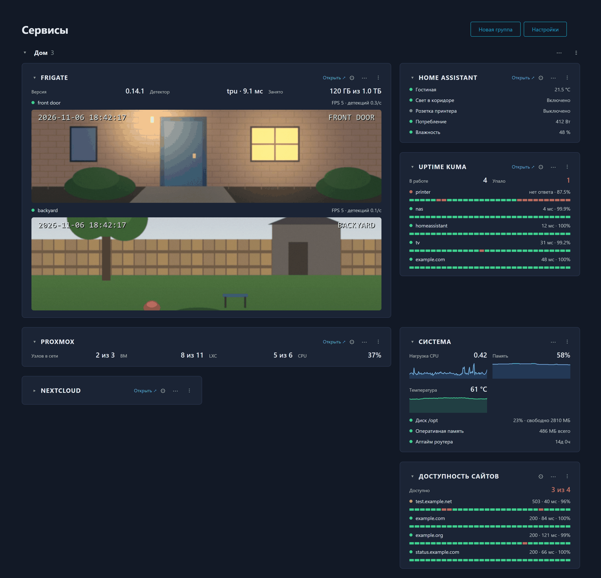
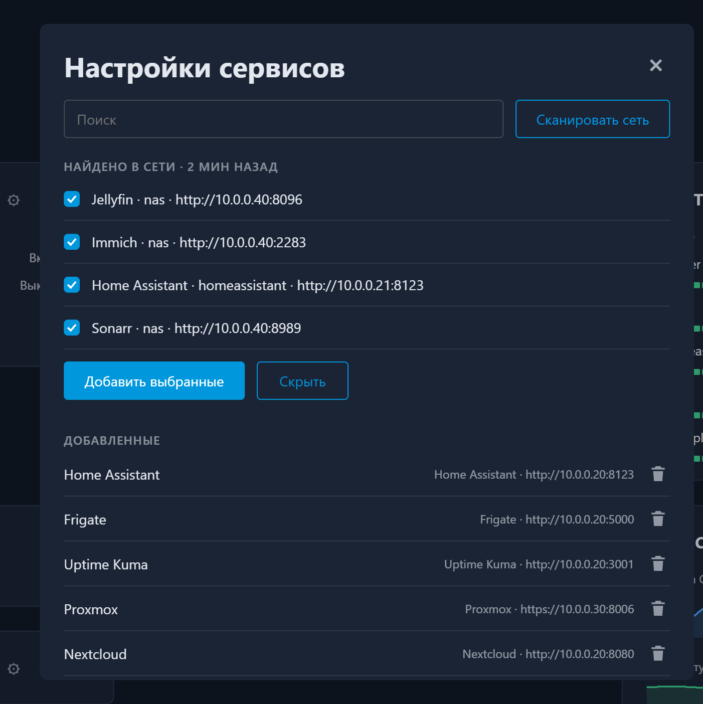

# keendash

Карточка «Сервисы» на главной странице веб-интерфейса Keenetic (NDMS) для сервисов, установленных через Entware, и
отдельная страница-дашборд для них и для сервисов в домашней сети.


- статус всех сервисов Entware и ссылки на их веб-страницы (порты определяются сами);
- вкладки с подробностями и графиками для поддерживаемых сервисов, вкладка видна, только если сервис установлен;
- больше 35 сторонних сервисов (медиа, умный дом, серверы, сеть, файлы): добавляются в окне настроек, в том числе
  через поиск в локальной сети;
- страница «Дашборд» (пункт в меню под «Системным монитором»): все карточки сразу, группы, ширина, сворачивание;
- проверка новой версии и обновление кнопкой на карточке.



<details>
<summary>Ещё изображения</summary>



 

</details>

<details>
<summary>Сервисы на роутере</summary>

| Вкладка | Сервис | Что показывает |
|---|---|---|
| telemt | telemt, telemt-panel | подключения, трафик, пользователи онлайн, аптайм, неудачные подключения |
| AWG | awg-manager | туннели (AmneziaWG, WireGuard, sing-box, OpkgTun): состояние, трафик, аптайм; раздача FreeTurn и WDTT |
| firc | firc | домены в пуле, группы и их интерфейсы |
| nfqws | nfqws2, nfqws-keenetic | процесс, пакеты в обработке, списки доменов, доступность сайтов из монитора nfqws-ui, события автолиста |
| Hydra | HydraRoute Neo (hrneo, hrweb) | процесс, правила: домены и адреса |
| Tailscale | tailscale | трафик и устройства с графиками, состояние и адрес роутера, выходной узел и подсети |
| Antiscan | Antiscan | заблокированные адреса и подсети, ловушка, последние баны со странами |
| Система | — | нагрузка CPU, память, температура, диск `/opt`, аптайм |

Если в awg-manager включён вход по паролю, сгенерируйте в его настройках API-ключ: keendash возьмёт его сам.

</details>

<details>
<summary>Сторонние сервисы</summary>

Сервисы на роутере или на любом устройстве в сети, данные берутся из их API. Появляются после [добавления](#сторонние-сервисы).

| Группа | Сервис | Что показывает |
|---|---|---|
| Медиа | qBittorrent | скорость загрузки и отдачи с графиками, активные загрузки |
| | Plex, Jellyfin | кто и что смотрит сейчас, библиотеки |
| | Sonarr, Radarr | очередь загрузок, сколько не скачано, что выходит на этой неделе |
| | Lidarr | очередь загрузок, сколько альбомов не скачано |
| | Prowlarr | индексаторы с ошибками, запросы и скачивания за сутки |
| | Overseerr, Jellyseerr | запросы: ждут одобрения, в работе, доступны |
| | Immich | фото, видео, занятое место |
| | Bazarr | серии и фильмы без субтитров |
| | Tautulli | потоки, перекодирование, трафик |
| | SABnzbd, NZBGet | скорость загрузки, сколько осталось |
| | Transmission, Deluge | скорость, число торрентов |
| | MeTube | загружается, скорость, готово, ошибки |
| Дом | Home Assistant | выбранные датчики и сущности |
| | Frigate | детектор, место, камеры, по желанию кадр с каждой камеры раз в минуту |
| | Moonraker | печать, прогресс, сколько осталось, температуры |
| | Spoolman | катушки, остаток, что почти кончилось |
| Серверы | Uptime Kuma | мониторы: работают и упали, доступность за сутки, полоса последних проверок |
| | Grafana | дашборды, сработавшие алерты |
| | Glances | CPU, память, swap, нагрузка |
| | Proxmox | узлы, работающие ВМ и LXC, CPU |
| | Portainer | контейнеры: запущено, остановлено |
| | TrueNAS | пулы, предупреждения, нагрузка |
| | OpenMediaVault | время работы, нагрузка, память |
| Сеть | AdGuard Home | запросы и блокировки с графиками, топ доменов, клиенты, последние блокировки |
| | Pi-hole (v6) | запросы и блокировки с графиками, топ доменов, клиенты |
| | NextDNS | запросы за сутки, заблокировано |
| | Speedtest Tracker | загрузка, отдача, пинг, последний замер |
| | Nginx Proxy Manager | прокси-хосты, перенаправления, потоки, ближайший сертификат |
| | Traefik | роутеры, сервисы, предупреждения и ошибки |
| Файлы | Nextcloud | свободное место, активные за сутки, файлы, ссылки |
| | Syncthing | синхронизация, устройства в сети, папки |
| | Paperless-ngx | документы, входящие, теги |
| Другое | Gitea / Forgejo | уведомления, задачи, PR, репозитории |
| | Свой API | любой адрес с JSON: плитки по вашему списку |
| Доступность | Доступность сайтов | отвечают ли ваши сайты: код, время ответа, доступность за сутки |

</details>

Работает на любых Keenetic с Entware.

## Установка

Узнайте архитектуру Entware (`opkg print-architecture`: `aarch64-3.10`, `mipsel-3.4` или `mips-3.4`), добавьте фид и установите пакет:

```sh
echo "src/gz keendash https://dnstkrv.github.io/keendash/aarch64-3.10" > /opt/etc/opkg/keendash.conf
opkg update && opkg install keendash
```

Других пакетов не нужно. После установки обновите страницу роутера (Ctrl+F5). Обновление: кнопкой на карточке или `opkg update && opkg upgrade keendash`.

## Настройка

### Сторонние сервисы

Сервисы добавляют, правят и удаляют в окне «Настройки» на странице «Дашборд»; один тип можно добавить несколько раз.
Кнопка «Сканировать сеть» ищет сервисы сама: роутер проверяет устройства в сети на стандартных портах и узнаёт сервис
по ответу (пароли при этом никуда не отправляются). Найденное отмечают галочками и добавляют, остаётся вписать ключ,
если сервис его требует, и нажать «Сохранить». Данные появятся в течение минуты.

Если сервис стоит на самом роутере, можно указать `http://127.0.0.1:порт`. Сервис, добавленный по имени хоста, поиск
может предложить ещё раз по IP-адресу. Переименованные Overseerr и Jellyseerr, Forgejo и Gitea со своим названием поиск
не узнаёт — их добавляют вручную.

<details>
<summary>Где взять ключи</summary>

- Sonarr, Radarr, Prowlarr, Lidarr, Overseerr, Jellyseerr: Settings → General → API Key; Bazarr: Settings → Security;
  Tautulli: Settings → Web Interface; SABnzbd: Config → General;
- Jellyfin: Панель управления → API-ключи; Immich: Настройки аккаунта → API-ключи (право `server.statistics`);
- Plex: токен из адреса страницы «View XML» у любого фильма ([инструкция Plex](https://support.plex.tv/articles/204059436-finding-an-authentication-token-x-plex-token/));
- Home Assistant: Профиль → Безопасность → Долгосрочные токены; Grafana: Administration → Service accounts, роль Viewer;
- Uptime Kuma: Settings → API Keys; Portainer: My account → Access tokens; TrueNAS: Credentials → API Keys (только по https);
- Proxmox: Datacenter → Permissions → API Tokens, роль PVEAuditor; в «Логин» ID токена (`root@pam!keendash`), в «API-ключ» секрет;
- Pi-hole: пароль веб-интерфейса или пароль приложения; NextDNS: в «Логин» ID профиля, API-ключ на странице Account;
- Speedtest Tracker: Settings → API Tokens (`results:read`); Nginx Proxy Manager: лучше пользователь только с просмотром;
- Nextcloud: токен serverinfo (Настройки → Система) или логин администратора и пароль приложения; Syncthing: Действия → Настройки → Общие;
- Paperless-ngx: профиль → API Auth Token; Gitea / Forgejo: Настройки → Приложения, права read на repository, issue, notification.

Логин и пароль не нужны там, где сервис пускает роутер без них. Сертификат Proxmox, Frigate, TrueNAS и Syncthing не
проверяется (он обычно самоподписанный); для остальных с самоподписанным сертификатом используйте http-адрес.

</details>

**Frigate: кадры с камер.** Настройка «Кадры с камер» показывает под каждой камерой кадр, обновляемый раз в минуту. Кадры
хранятся только в памяти роутера и видны, когда веб-интерфейс открыт по https.

**Доступность сайтов.** До 20 доменов или адресов через пробел, проверка раз в 1–60 минут. Доступным считается любой
ответ сервера; история за сутки сбрасывается при перезагрузке роутера.

**Свой API.** Любой адрес с JSON. В «Что показывать» через `;` до 8 пар `Подпись=путь[:формат]`, например
`Задачи=queue.total; Скорость=speed:bs`. Форматы: `n` число, `b` байты, `bs` байты в секунду, `bit` биты в секунду,
`p` проценты, `s` секунды; без формата — текст.

### Страница «Дашборд»

- карточки перетаскиваются за «⋮⋮» и встают вплотную под ту, что выше в колонке;
- «⋯» — ширина 1/3, 2/3 или 3/3, «▾» — свернуть, «⚙» — настройки этого сервиса;
- «Новая группа» объединяет карточки, группу можно переименовать, свернуть и разгруппировать;
- раскладка хранится на роутере и одинакова во всех браузерах; на узком экране карточки идут в одну колонку;
- в окне настроек каждую карточку можно скрыть отдельно на странице и на главной.

### Файл настроек

`/opt/etc/keendash/keendash.conf`:

```sh
PORT=8189          # порт веб-сервера карточки
LAN_IFACE="br0"    # интерфейс, на адресе которого он слушает
LAN_IP=""          # или явный адрес
GEO=1              # страны у адресов Antiscan (0 = выключить)
LINKS="            # свои ссылки на веб-страницы сервисов
firc=666
telemt=hide
"
```

`LINKS`: `имя=порт`, `имя=http://хост/путь`, `имя=-` (без ссылки), `имя=hide` (скрыть сервис). После правки:
`/opt/etc/init.d/S81keendash restart`.

## Безопасность

- Настройки сервисов, включая пароли и ключи, лежат в `/opt`: любой, кто вошёл в веб-интерфейс роутера, может прочитать
  их через файловый менеджер прошивки. Давайте сервисам ключи с минимальными правами.
- Страны в Antiscan определяются через ip-api.com по http: заблокированные адреса уходят в сторонний сервис. Отключить:
  `GEO=0`.
- По https (в том числе через KeenDNS) карточка берёт данные через сам веб-интерфейс роутера, новых портов не открывается.

## Ограничения

- Ссылки «Открыть» ведут на адрес роутера в локальной сети и из интернета обычно не откроются.

## Удаление

`opkg remove keendash`

## Лицензия

MIT
